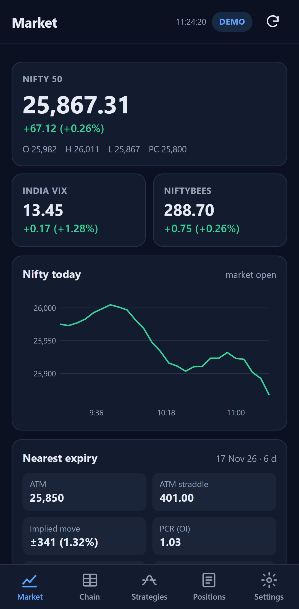
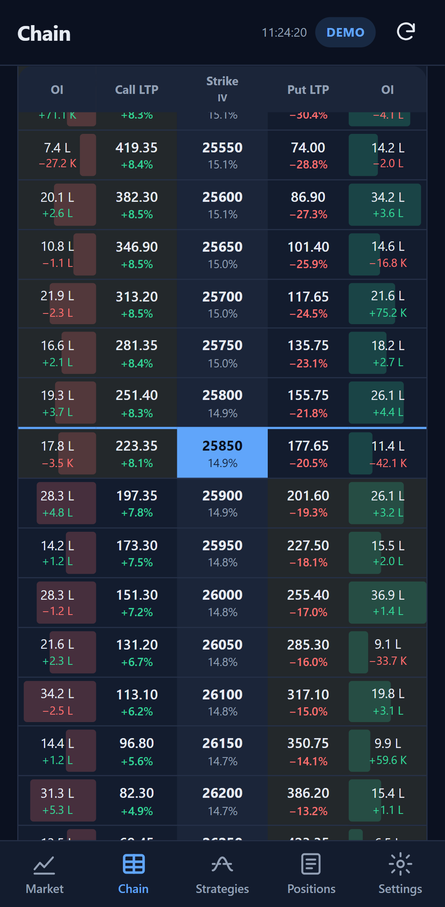
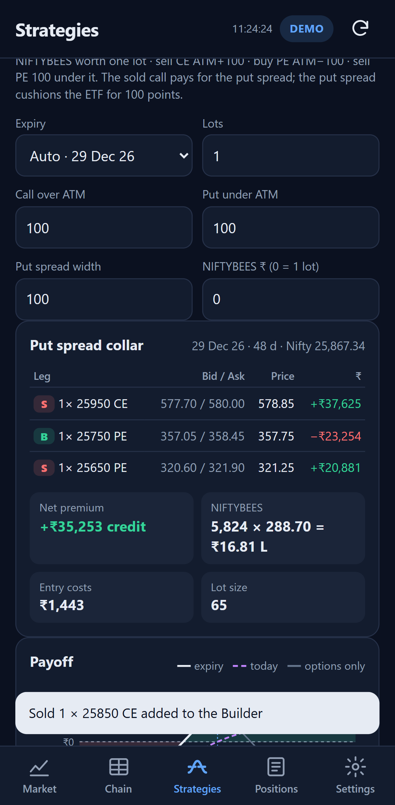
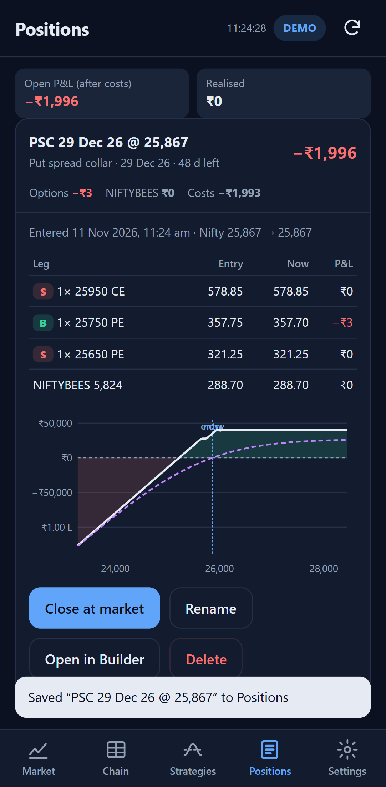

# Nifty Options Mobile

The Nifty options portal for an **Android phone**, as an installable web app (PWA):

- **No server of its own.** Everything runs on the phone. The only connection it makes is to `api.upstox.com`.
- **Not a native app.** HTML, CSS and JavaScript with no framework, no build step and no runtime dependencies.
- **Self-contained.** Nothing in this folder uses the rest of the repository. It can be copied out and live on its own.

| Market | Chain | Collar | Positions |
| --- | --- | --- | --- |
|  |  |  |  |

## What it does

| Screen | |
| --- | --- |
| **Market** | Nifty 50, India VIX, NIFTYBEES; today's Nifty chart; the nearest expiry's ATM straddle, implied move, PCR, max pain, support and resistance |
| **Chain** | Any expiry, ±5–20 strikes: LTP, change, OI with bars, change in OI, IV. Tap a price to Buy/Sell it into the Builder |
| **Strategies** | **Put spread collar** and **Bull put collar** (the desktop portal's legs) live from the chain, with NIFTYBEES sizing, charges, payoff (expiry and today), max P/L, breakevens and Greeks. **Builder** for any legs |
| **Positions** | Paper positions saved on the phone, marked to market at bid/ask mid after charges; close, rename, delete, open in Builder |
| **Settings** | Upstox login (on the phone) or pasted token; Demo data; refresh; lot size, slippage, brokerage; theme; backup export/import |

It places **no orders**. It is not investment advice.

## Quick start

```bash
npm install
```

```bash
npm run serve
```

Then open <http://localhost:8080/>. It starts on Demo data.

To put it on your phone, follow **[docs/INSTALL-ANDROID.md](docs/INSTALL-ANDROID.md)**. In short: publish `www/` to
GitHub Pages or Netlify, open the address in Chrome on the phone, ⋮ › **Install app**, then log in to Upstox in
Settings.

## Folder

```
www/                 the app; exactly what is published
  index.html  manifest.webmanifest  sw.js (offline cache)  css/  icons/
  js/app.js          shell: tabs, refresh loop, status, Upstox login return, updates
  js/views/          market · chain · strategies · positions · settings
  js/upstox.js       Upstox REST client + OAuth (browser-side)
  js/demo.js         simulated market (same interface)
  js/market.js       data layer: picks the source, shares requests, keeps last-good copies
  js/bs.js  strategy.js  analytics.js  costs.js  time.js  charts.js  store.js  positions.js  ui.js
tools/serve.js       static file server for local and Wi-Fi testing
tools/stamp.mjs      writes the service worker's build number and file list (run before publishing)
tools/make-icons.mjs draws the PNG icons
tools/screenshots.mjs
test/                unit tests (node --test)
e2e/                 Playwright tests in Android phone emulation
deploy/              GitHub Pages workflow for this repository
.github/workflows/   GitHub Pages workflow when this folder is its own repository
docs/                DESIGN.md · INSTALL-ANDROID.md · TESTING.md
```

## Commands

| | |
| --- | --- |
| `npm run serve` / `npm run serve:lan` | serve `www/` on this PC / also on the Wi-Fi address |
| `npm test` | unit tests |
| `npm run test:e2e` | phone-emulation tests (`PW_CHANNEL=msedge` to use the installed Edge) |
| `npm run stamp` | **before every publish**: new service-worker build so phones update |
| `npm run check` | stamp + all tests |
| `npm run icons` / `npm run screenshots` | redraw icons / retake doc screenshots |

## Docs

- [docs/DESIGN.md](docs/DESIGN.md): why a PWA, the architecture, screens, sign-in, storage, calculations, and the Kite limitation
- [docs/INSTALL-ANDROID.md](docs/INSTALL-ANDROID.md): deploy, install, connect Upstox, update, APK option, troubleshooting
- [docs/TESTING.md](docs/TESTING.md): unit, end-to-end (phone emulation), real phone and Android Studio emulator

## Limits

- **Upstox only.** Zerodha Kite's API cannot be called from a browser (no CORS) and this app has no server by design.
- **Exchange holidays** are not known; on a holiday the app just shows the last prices.
- **Expired positions** are valued at intrinsic against the latest Nifty, not the official expiry settlement price.
- **Margin** is not computed.
- The collar's NIFTYBEES payoff curve assumes the ETF moves with Nifty; the live P&L uses NIFTYBEES's real price.
