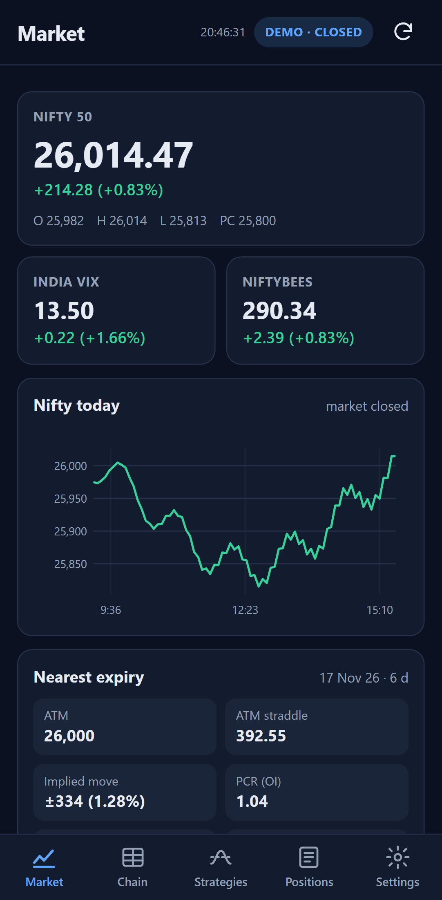
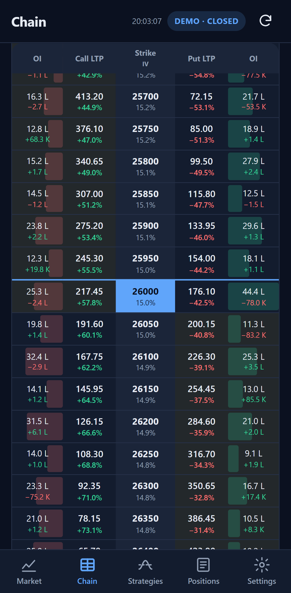
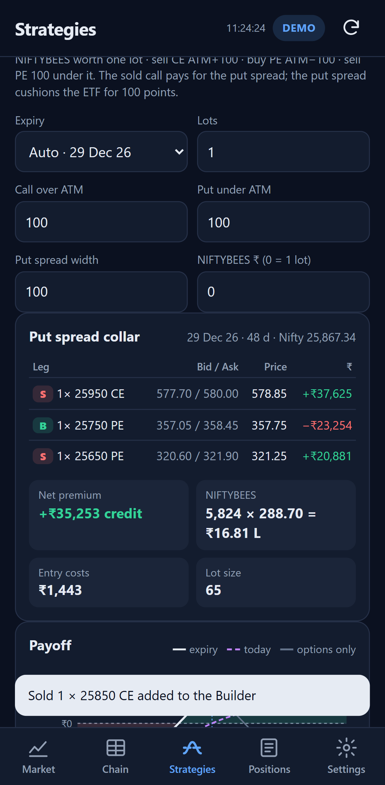
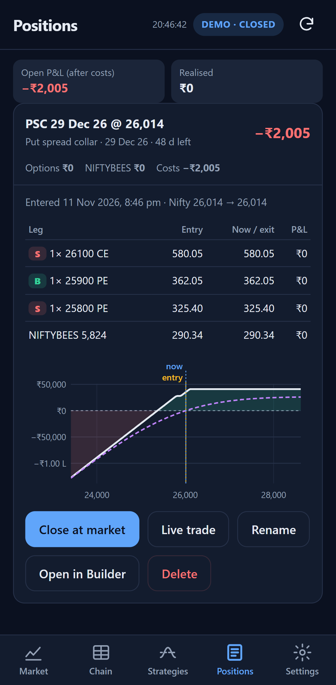

# Deploy and install on an Android phone

The app is a folder of static files (`MobileApp/www`). You put that folder on a free HTTPS host once, open the
address in Chrome on the phone, and choose **Install app**. From then on it starts from the phone's home screen,
works without the host, and talks only to `api.upstox.com`.

**Why a host at all?** Android's Chrome installs web apps only from an `https://` address (or `localhost`). The host
only delivers the files. It never sees your token, prices or positions, and nothing is sent back to it.

Contents:

1. [Choose where the files live](#1-choose-where-the-files-live) (GitHub Pages, Netlify, or your PC for testing)
2. [Install on the phone](#2-install-on-the-phone)
3. [Connect Upstox](#3-connect-upstox)
4. [Updating the app](#4-updating-the-app)
5. [Optional: an APK for the Play Store or sideloading](#5-optional-an-apk-trusted-web-activity)
6. [Troubleshooting](#6-troubleshooting)

---

## 1. Choose where the files live

### Option A: GitHub Pages from this repository (recommended)

The repository `jobshari2/OptionsBacktesting_claude` is public, so Pages is free.

1. Copy the workflow into the repository root:

   ```bash
   mkdir -p .github/workflows
   ```

   ```bash
   cp MobileApp/deploy/github-pages-from-this-repo.yml .github/workflows/mobile-pages.yml
   ```

2. Commit and push to `main`. This alone does not start a run: the workflow starts by itself only when a push
   changes something under `MobileApp/`.
3. **Before the first run**, on github.com: **Settings › Pages › Build and deployment › Source: GitHub Actions**
   (<https://github.com/jobshari2/OptionsBacktesting_claude/settings/pages>). Without it the publish step fails.
4. Open **Actions**, click **Mobile app to GitHub Pages** in the left-hand list (it may be under *Show more
   workflows*), then the grey **Run workflow ▾** button above the list of runs, and the green **Run workflow**.
   Direct link: <https://github.com/jobshari2/OptionsBacktesting_claude/actions/workflows/mobile-pages.yml>. The
   button shows only to accounts that can write to the repository.
5. When it finishes, the app is at **`https://jobshari2.github.io/OptionsBacktesting_claude/`**.

Every later push that changes `MobileApp/` republishes it. The workflow runs the unit tests and stamps the service
worker, so phones see "A new version is ready".

> The published files are public, which is fine: they contain no keys, tokens or data. Your Upstox key, secret,
> token and positions exist only on your phone.

### Option B: the app in a repository of its own

`MobileApp/` is self-contained. Copy its contents into a new GitHub repository (the folder becomes the root). It
already contains `.github/workflows/pages.yml`. Then do steps 3–5 above. The address becomes
`https://<you>.github.io/<new-repo>/`.

### Option C: Netlify Drop (no Git, two minutes)

1. Run `npm run stamp` in `MobileApp/` (see [Updating](#4-updating-the-app)).
2. Open <https://app.netlify.com/drop> on the PC and drag the **`MobileApp/www`** folder onto the page.
3. Netlify gives you an `https://….netlify.app` address. Use it in section 2.

To update, drag the folder again on the site's **Deploys** page. Cloudflare Pages ("Upload assets") works the same way.

### Option D: from your PC, for testing only

Needs Node 20+ on the PC.

```bash
cd MobileApp
```

```bash
npm run serve:lan
```

The command prints an address like `http://192.168.1.20:8080/`. Opening it on a phone on the same Wi‑Fi **shows**
the app, but Chrome will not **install** it or let it work offline from a plain `http://` LAN address. Two ways round
that:

- **USB cable (proper install):** enable *Developer options › USB debugging* on the phone, install Android
  platform-tools on the PC, then run the command below and open `http://localhost:8080/` on the phone. The phone
  treats it as `localhost`, so it is a secure address and the app installs.

  ```bash
  adb reverse tcp:8080 tcp:8080
  ```

- **Chrome flag (Wi‑Fi):** on the phone open `chrome://flags/#unsafely-treat-insecure-origin-as-secure`, add
  `http://192.168.1.20:8080`, set it to *Enabled*, and relaunch Chrome.

For daily use, prefer A, B or C: then the PC does not have to be on.

---

## 2. Install on the phone

1. Open the address from section 1 in **Chrome** on the Android phone.
2. Either tap **Install** in the banner, or open Chrome's **⋮** menu and choose **Install app** (older Chrome versions
   say **Add to Home screen**).
3. Confirm. The **Nifty Options** icon appears on the home screen and in the app drawer.
4. Open it from the icon. It runs full-screen with no address bar. Long-press the icon for the shortcuts
   *Option chain* and *Positions*.

The first start uses **Demo** data (a simulated market), so every screen shows something before you connect Upstox.

| Market | Chain | Collar | Positions |
| --- | --- | --- | --- |
|  |  |  |  |

---

## 3. Connect Upstox

Upstox access tokens expire at about **03:30 IST every day**, so you log in once each trading day. Choose one way.

### 3a. Log in with Upstox on the phone (recommended)

One-time setup, on the PC:

1. Go to <https://account.upstox.com/developer/apps> and **create a new app** for the phone. A separate app keeps
   the phone's daily login from replacing the desktop portal's token.
2. Set its **Redirect URL** to the app's address exactly, including the trailing slash, for example
   `https://jobshari2.github.io/OptionsBacktesting_claude/`.
3. Note the **API key** and **API secret**.

On the phone:

1. Open the app, go to **Settings › Upstox › Log in with Upstox (API key)**.
2. Enter the API key and secret. Leave *Redirect URL* empty if it is the app's own address (shown greyed in the
   box), or type the one you registered.
3. Tap **Log in with Upstox**, sign in on Upstox's page (mobile number, OTP, PIN), and you come back to the app.
   The chip at the top changes from **LOG IN** to **LIVE**.

Each following day: Settings › **Log in with Upstox**. The key and secret are remembered.

> The secret is kept in this browser's storage on the phone. Anyone who can unlock your phone and open the app could
> read it. If that worries you, use 3b instead and leave the secret empty.

### 3b. Paste a token

Settings › Upstox › **Paste an access token instead**. Paste any valid Upstox access token (for example
`UPSTOX_ACCESS_TOKEN` from the desktop portal's `.env`) and tap **Use this token**.

### Switching data

Settings › **Data source**: *Upstox (live)* or *Demo (simulated)*. Demo needs no account and no network.

### Zerodha Kite

Not available in this app. Kite's API refuses calls made from a browser (it sends no CORS headers), and getting
round that needs either a server, which this app does not have by design, or a native wrapper. See
[DESIGN.md §9](DESIGN.md#9-kite-later-if-needed).

---

## 4. Updating the app

1. Change files in `MobileApp/www`.
2. In `MobileApp/`, run the stamp. It writes a new build number and file list into `www/sw.js`; without it, phones
   keep the old version.

   ```bash
   npm run stamp
   ```

3. Publish (push for GitHub Pages, which also stamps; or drag the folder again on Netlify).
4. On the phone, open the app. Within a few seconds a bar says **A new version is ready. Reload**. Tap it. You can
   also use Settings › **Check for update**.

Your settings, token and positions are not touched by updates.

---

## 5. Optional: an APK (Trusted Web Activity)

If you want an `.apk` file (to sideload, or for the Play Store), wrap the hosted app with Google's Trusted Web Activity
tooling. It is still this web app running in Chrome, not a native app.

1. Publish the app (section 1) and open <https://www.pwabuilder.com>.
2. Enter the app's address and choose **Package for stores › Android**. Download the package. It contains the APK
   and a signing key; keep the key safe.
3. Copy the APK to the phone and open it (allow *Install unknown apps* for your file manager).
4. For full-screen without Chrome's URL strip, the host must serve the `assetlinks.json` from the package at
   `https://<host>/.well-known/assetlinks.json`. On GitHub Pages that means a repository named
   `<you>.github.io` or a custom domain. On Netlify, add the file at `www/.well-known/assetlinks.json` and deploy
   again.

For one phone, installing from Chrome (section 2) does the same job with less work.

---

## 6. Troubleshooting

| What you see | What to do |
| --- | --- |
| No **Install app** in Chrome's menu | The address must be `https://` (or `localhost` over USB). Plain `http://192.168…` cannot install; see Option D. |
| Upstox page says the redirect URI is invalid | The Redirect URL in the Upstox app must match the app's address character for character, including `https` and the trailing `/`. |
| "Upstox login failed: Check your client_id and client_secret" | Re-enter the API key and secret in Settings; there must be no spaces. |
| Chip shows **LOG IN** in the morning | The token expired at 03:30 IST. Log in again. |
| Chip shows **OFFLINE** or **ERROR**, time ends in "(saved)" | No connection to Upstox. The screen shows the last prices saved on the phone. Tap the chip to read the error. |
| Prices do not move | Outside 09:15–15:30 IST, Monday–Friday, the app refreshes once a minute and Upstox's prices are the close. Exchange holidays are not known to the app. |
| Old version keeps showing | Run `npm run stamp` before publishing. On the phone: Settings › Check for update, then tap Reload. |
| Positions vanished | Positions live in Chrome's storage for this app. Clearing Chrome's site data or uninstalling removes them. Use Settings › **Export backup** regularly; **Import backup** restores. |
| Moving to a new phone | Export a backup on the old phone, send the file to the new one, install the app there, Settings › Import backup. The API secret is not included; enter it again. |
