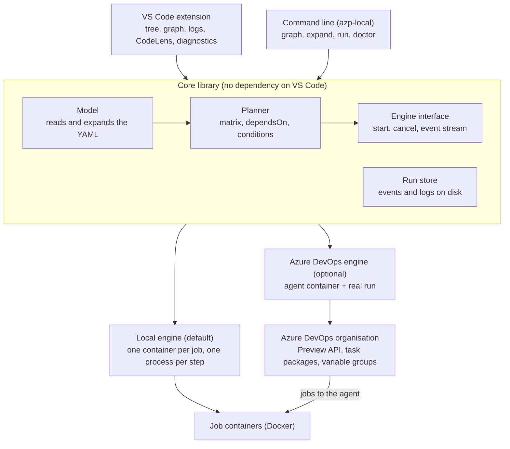

# Local Azure Pipelines Runner for VS Code — Analysis and Design

Status: proposal, nothing built · Date: 2026-10-11 · Applies to: any repository with an Azure Pipelines YAML file

## 1. Summary

Build a VS Code extension, with a matching command line, that draws any `azure-pipelines.yml` as the Azure DevOps portal does and runs its jobs in Docker containers on the developer's machine. Nothing available today does both.

- **Viewing** needs only template expansion. The extension expands locally and checks itself against Azure DevOps' own Preview API when an organisation is connected.
- **Running** uses a local engine by default: one container per job, one process per step, the pipeline's own tasks executed from their published code. It works offline, with no account, on the unsaved file.
- **A real Azure DevOps agent in a Docker container is a second mode,** not the default. The agent only accepts work from an Azure DevOps server, so that mode needs an organisation and a pushed branch. It is the exact answer; the local engine is the fast one.
- **It is generic by construction.** The tool knows nothing about any language or application. One optional file per repository maps pools to images and says what to do with steps that cannot run locally.
- **It does not claim more than it did.** A step that could not run locally is shown as such and never counted as passed.

Section 14 lists six questions whose answers would change parts of this design.

## 2. Problem and goals

A pipeline file can only be seen and tried by pushing it. Every change to `azure-pipelines.yml` costs a commit, a queue wait and a portal visit, and a typo in a template or a condition is found minutes later. The pipeline written for this repository has not run once for that reason.

### Goals

1. **See it in VS Code.** Stages, jobs and steps as a graph and a tree, with matrix legs, dependencies and conditions, laid out as the Azure DevOps run page lays them out.
2. **Run it locally.** One job, one stage or the whole pipeline, in Docker containers that stand in for the hosted agent images, with live logs per step and the same pass, fail and skip states as the portal.
3. **Work on any repository.** No assumption about language, file name or layout. Anything specific to a repository lives in one optional configuration file.
4. **Be honest about differences.** Where a local run cannot match Azure DevOps, the tool says so on that step and does not report a false pass.
5. **Ship as a VS Code extension** that works with no Azure DevOps account, and does more when one is connected.

### Non-goals

- Replacing Azure DevOps as the system of record. A local green run does not satisfy a branch policy.
- Deploying. Steps that need a service connection to a cloud are skipped or stubbed by default.
- Classic (non-YAML) pipelines and release pipelines.
- Running macOS jobs. They need Apple hardware and cannot run in a container.

### Who uses it and for what

| User | Wants | Success looks like |
| --- | --- | --- |
| Developer editing a pipeline | To know a change works before pushing | Edits YAML, presses *Run job*, sees the failing step in under a minute |
| Developer whose CI run failed | To reproduce the failure | Runs the failed job locally, opens a shell in the kept container |
| Reviewer of a pipeline change | To understand what the file does | Opens the graph; sees stages, matrix legs and conditions without reading templates |
| Team adopting the tool | The same local behaviour for everyone | Commits one config file; teammates need no further setup |

## 3. What exists today

No supported tool both draws an Azure pipeline and runs it on a laptop. Each existing piece covers one part.

| Piece | What it gives | What it lacks |
| --- | --- | --- |
| [Azure Pipelines extension](https://marketplace.visualstudio.com/items?itemName=ms-azure-devops.azure-pipelines) (Microsoft) | Syntax highlighting, schema validation and IntelliSense for the YAML | No graph, no template expansion, no run |
| [Preview REST API](https://learn.microsoft.com/en-us/rest/api/azure/devops/pipelines/preview/preview?view=azure-devops-rest-7.1) | The server's own expansion: send `previewRun: true` with a `yamlOverride` and get back `finalYaml`, without committing | Needs an organisation, an existing pipeline definition and a token. Expands only; runs nothing |
| [Self-hosted agent in Docker](https://learn.microsoft.com/en-us/azure/devops/pipelines/agents/docker?view=azure-devops) (Microsoft) | The real agent in a container on your machine, executing real tasks. `--once` gives a fresh container per job | The agent only takes work from an Azure DevOps server (`AZP_URL` and a token are required). The run is of pushed code, queued in the portal, not of the file in your editor |
| [runner.server](https://github.com/ChristopherHX/runner.server) (community, MIT) | A local server that the official agent connects to; `Runner.Client --event azpipelines -W pipeline.yml` runs a pipeline offline | Its README calls Azure Pipelines support experimental and a subset. Command line only |
| [Azure Pipelines Tools](https://marketplace.visualstudio.com/items?itemName=christopherhx.azure-pipelines-vscode-ext) (same author) | Validates and expands templates locally in VS Code, with a live preview of the expanded YAML | Text preview only, no graph and no run. Predefined variables must be supplied by hand |
| [Microsoft-hosted images](https://learn.microsoft.com/en-us/azure/devops/pipelines/agents/hosted?view=azure-devops) | The software list of `ubuntu-24.04`, `windows-2025` and the rest; build scripts are public in `actions/runner-images` | They are virtual machine images. Microsoft does not publish them as containers |

Three facts from this survey shape the design:

- **The agent cannot be handed a YAML file.** It executes job messages that a server has already planned. Something must play the server: Azure DevOps itself, an emulator of its protocol, or an engine that replaces the agent.
- **Expansion and execution are separable.** Drawing the pipeline needs only expansion, which can be exact (Preview API) when an organisation is connected.
- **A local container is never the hosted image.** Tool versions will differ unless the pipeline installs its own, as `UseNode@1` does.

### How a real run works, and where a local tool can cut in

Understanding the real sequence shows the three places a local tool can attach.

1. A trigger or a person queues a run. The server reads the YAML at a commit.
2. The server expands templates and `${{ }}` expressions into one document (what the Preview API returns as `finalYaml`).
3. The server builds a plan: stages, jobs per matrix leg, dependencies. Approvals and checks gate stages.
4. For each job whose dependencies and condition allow it, the server finds an agent in the pool and sends it one job message: the steps, variables, endpoints and the list of tasks with versions.
5. The agent downloads any task packages it does not have, checks out the repository, and runs each step. A task is a folder with a `task.json` manifest and a handler (a Node script or a PowerShell script).
6. Each step writes to standard output. Lines of the form `##vso[area.action key=value]data` are commands back to the agent: set a variable, upload a file, mark the result.
7. The agent streams logs and a timeline (state per step) to the server, which the portal draws.

| Attach point | Replaces | Corresponds to |
| --- | --- | --- |
| After step 1 | Nothing; use the real service with a local agent | Option A |
| At step 2 | The whole server and the agent | Option B |
| At step 4 | The server only; keep the real agent | Option C |

## 4. Options considered

Three ways to execute were weighed. The recommendation is option B as the default engine, with option A offered as a second mode behind the same interface.

| | A. Real agent, real server | B. Local engine (recommended default) | C. Emulated server, real agent |
| --- | --- | --- | --- |
| How it works | A throwaway agent container registers with your organisation; the extension pushes a scratch branch and queues a run on that agent | The extension expands the YAML itself and runs each step with `docker exec` in a job container. Tasks run from their published source | A local process speaks the agent protocol; the official agent runs in a container and executes what it is sent |
| Works offline, no account | No | Yes | Yes |
| Runs the unsaved file in the editor | No, only pushed commits | Yes | Yes |
| Task fidelity | Exact | High for Node-based tasks, none for tasks the engine does not carry | Exact for tasks it can download |
| Template and expression fidelity | Exact | As good as our expander; checked against the Preview API | As good as the emulator's expander |
| Start-up time per job | Slow: agent download, registration, queue | Fast: container start only | Medium: agent start and handshake |
| What we must build | Little: orchestration of `docker run` and REST calls | Most: expander, scheduler, step runner, logging commands | Most of all: a server protocol that is not a public contract |
| Main risk | Pollutes the organisation with scratch branches, runs and agents | We chase Azure DevOps behaviour for ever | The protocol changes without notice; one community project already carries this cost |

**Why B first.** The goal is a tight loop on the file being edited, and only B and C give that. C's fidelity gain is in task execution, and B gets most of it by running the tasks' own code (section 7). C's cost is a private protocol.

**Why keep A.** It is the only mode that is exactly Azure DevOps, and it is cheap to add. It answers "will this pass on the real service?" before a pull request, on your own hardware.

**Why not only A,** which is what "create an agent locally as a Docker container" suggests. It does work, and Microsoft documents it. But the run is still planned and displayed by Azure DevOps: it needs an organisation, a token with the *Agent Pools (read, manage)* scope, a pipeline definition, and the change pushed to a branch. It does not give a local loop; it gives a local machine for a remote loop.

**Reusing runner.server** as the engine for C stays open as a later third engine. The extension talks to engines through one interface, so adding it does not change the views. The phase 0 spike tries it on the same files before the build decision is final.

### Option A in detail

1. The extension builds (once) the agent image from Microsoft's documented Dockerfile and `start.sh`.
2. It creates or reuses an agent pool named for the user, for example `local-<user>`.
3. It starts the container with `AZP_URL`, `AZP_POOL`, `AZP_AGENT_NAME` and the token passed as a file, and `--once`.
4. It pushes the current state to a scratch branch `azp-local/<user>/<timestamp>` (a commit of the working tree, made without touching the user's branch or index).
5. It queues a run of the pipeline on that branch, overriding the pool to the local one. Where the YAML names `vmImage`, the override needs the pipeline to take the pool from a parameter or variable; otherwise the extension sends a `yamlOverride` only for preview and warns that the pool must be parameterised.
6. It polls the run's timeline and logs through REST and replays them as engine events.
7. On completion it removes the agent registration, the container and the scratch branch.

Open points for A: `windows-*` jobs need a Windows agent container or a host agent; one container serves one job at a time, so a matrix needs several containers.

## 5. Recommended architecture

The tool is a core library with two front ends, a VS Code extension and a command line, so that everything the extension does can also run in a terminal or a script.



| Component | Responsibility | Depends on |
| --- | --- | --- |
| **Model** | Reads the YAML with source positions, expands templates and expressions, and produces one typed tree: pipeline → stages → jobs → steps | Nothing outside the workspace; optionally the Preview API |
| **Planner** | Turns the tree and a selection ("this job", "from this stage") into an ordered plan: matrix legs, `dependsOn`, conditions, what is skipped and why | Model |
| **Engine interface** | `start(plan)`, `cancel()`, and a stream of events: job started, step started, log line, step finished, variable set | Planner |
| **Local engine** (option B) | Runs the plan in containers through the Docker API | Docker, task cache |
| **Azure DevOps engine** (option A) | Runs the plan on a local agent container registered to the organisation and relays the real run's timeline | Docker, Azure DevOps REST |
| **Run store** | Keeps each run's events and logs on disk so past runs can be reopened | Workspace storage |
| **VS Code extension** | Tree, graph, log views, commands, settings, secret prompts | Core library |
| **CLI** (`azp-local`) | `graph`, `expand`, `run`, `doctor` with the same options | Core library |

### How a local run flows

1. The model expands the file open in the editor, unsaved changes included, and reports errors as editor diagnostics.
2. The planner resolves the selection. Running one job also schedules the jobs it depends on, unless their outputs are cached from an earlier run.
3. For each job the engine picks an image for its `pool`, creates a container with the workspace copied or mounted in, and creates per-run folders for artifacts and temp files.
4. Each step runs with `docker exec`. The engine parses `##vso[...]` logging commands from its output to set variables, add to the path, upload summaries and mark results.
5. Events stream to the run store and the views. A step ends as succeeded, failed, succeeded with issues, skipped or unsupported.
6. Containers are removed when the run ends, or kept on failure if the user asks to debug.

### The contracts

The event stream is the contract between engines and views. Both engines emit the same events, so the graph and logs look the same whichever one ran. A sketch in TypeScript:

```ts
interface Engine {
  readonly id: 'local' | 'azure-devops' | string;
  start(plan: RunPlan, io: RunIO): RunHandle; // RunIO: secrets, prompts, config
}
interface RunHandle {
  readonly events: AsyncIterable<RunEvent>;
  cancel(): Promise<void>;
}
type RunEvent =
  | { type: 'run.started'; runId: string; at: number }
  | { type: 'job.started'; jobId: string; image: string; at: number }
  | { type: 'step.started'; jobId: string; stepId: string; at: number }
  | { type: 'log'; jobId: string; stepId: string; line: string; stream: 'out' | 'err'; at: number }
  | { type: 'issue'; jobId: string; stepId: string; severity: 'error' | 'warning'; message: string; source?: SourceRef }
  | { type: 'variable.set'; jobId: string; name: string; isOutput: boolean; isSecret: boolean }
  | { type: 'artifact'; jobId: string; name: string; path: string }
  | { type: 'step.finished'; jobId: string; stepId: string; result: StepResult; at: number }
  | { type: 'job.finished'; jobId: string; result: JobResult; at: number }
  | { type: 'run.finished'; result: JobResult; gaps: string[]; at: number };

type StepResult = 'succeeded' | 'succeededWithIssues' | 'failed' | 'canceled' | 'skipped' | 'unsupported';
type JobResult = StepResult | 'succeededWithGaps';
interface SourceRef { file: string; line: number; column: number; via?: SourceRef } // via = the template include chain
```

The model's output, also sketched:

```ts
interface Pipeline { name?: string; file: string; triggers: TriggerInfo; stages: Stage[]; diagnostics: Diagnostic[] }
interface Stage { id: string; displayName: string; dependsOn: string[]; condition: Expr; jobs: Job[]; src: SourceRef }
interface Job {
  id: string; displayName: string; kind: 'job' | 'deployment';
  dependsOn: string[]; condition: Expr; pool: PoolSpec; container?: ContainerSpec;
  matrixLeg?: { name: string; variables: Record<string, string> };
  services: Record<string, ContainerSpec>; variables: VariableDecl[];
  steps: Step[]; timeoutInMinutes?: number; src: SourceRef;
}
interface Step {
  id: string; displayName: string;
  run: { kind: 'script'; shell: 'default' | 'bash' | 'pwsh' | 'powershell'; script: string }
     | { kind: 'task'; name: string; version: string; inputs: Record<string, string>; tier: 1 | 2 | 3 }
     | { kind: 'checkout'; repository: string; fetchDepth?: number }
     | { kind: 'download' | 'publish'; artifact: string; path?: string };
  condition: Expr; continueOnError: boolean; enabled: boolean; env: Record<string, string>;
  timeoutInMinutes?: number; retryCount?: number; src: SourceRef;
}
```

## 6. Pipeline model and YAML expansion

The model is the part that must be right first, because both the picture and the run are built from it. Azure Pipelines evaluates a file in three passes, and the model keeps them apart.

| Pass | Syntax | When Azure evaluates it | Local handling |
| --- | --- | --- | --- |
| Template | `${{ parameters.x }}`, `${{ if }}`, `${{ each }}`, `template:` | Before the run is planned | Expanded by the model. Parameter values come from defaults, the config file or a prompt |
| Runtime expression | `$[ ... ]`, `condition:`, `dependencies.job.outputs[...]` | When a stage or job is about to start | Evaluated by the planner as the run proceeds |
| Macro | `$(var)` | Just before each step | Substituted by the engine, including variables set by earlier steps |

### What the model must cover

- Shorthand forms: a file with only `steps:`, or only `jobs:`, is one implicit stage and job.
- `template:` for stages, jobs, steps and variables, with typed parameters; `extends:` templates.
- Templates from other repositories (`resources.repositories` and `file@alias`). The config file maps each alias to a local folder; unmapped aliases are an error on the line that uses them.
- `strategy.matrix`, `parallel` and `maxParallel`; each matrix leg becomes its own job node.
- `dependsOn` and `condition` at stage and job level, with the default `succeeded()`.
- Variables at every level, variable templates, and variable groups (supplied locally, section 7).
- Predefined variables: `Build.SourcesDirectory`, `Agent.OS`, `System.JobAttempt` and the rest get local values. `Build.Reason` defaults to `Manual` and can be set to `PullRequest` to exercise those branches.
- `deployment` jobs with `runOnce`, `rolling` and `canary` lifecycle hooks, flattened to their steps. Environments and approvals are shown, not enforced.

### The expression language

One evaluator serves both `${{ }}` and `$[ ]`; they differ in which contexts are available.

| Element | Scope for the first release |
| --- | --- |
| Literals and types | string, number, boolean, null, version; Azure's coercion rules for comparisons |
| Contexts | `parameters`, `variables`, `dependencies`, `stageDependencies`, `pipeline`, `resources` (compile time: `parameters`, `variables` with static values only) |
| Access | `a.b`, `a['b']`, `a.*.b` filtered arrays |
| Functions | `eq ne gt ge lt le and or not xor in notIn contains containsValue startsWith endsWith coalesce format join length lower upper replace split trim convertToJson counter iif` |
| Status functions | `succeeded() failed() succeededOrFailed() always() canceled()`, with job-name arguments |
| Control | `${{ if }}` / `elseif` / `else`, `${{ each x in y }}`, `${{ insert }}` |

`counter()` needs server state and is emulated per workspace. Anything not in the table is a diagnostic naming the construct, not a silent pass-through.

### Design decisions

- **D1. One expander, checked against the server.** The model has its own expander written in TypeScript. When an organisation is connected, a command sends the same file to the Preview API and diffs `finalYaml` against the local result. The same comparison runs in the project's own tests over a corpus of pipelines.
- **D2. Source positions survive expansion.** Every node records the file and line it came from, through templates. Clicking a node opens that line; a failed step puts a diagnostic on it.
- **D3. Unknown is shown, not guessed.** A condition that depends on something unknowable locally (a variable group value that was not supplied) renders as "depends on" with the expression, and the run asks before it proceeds.
- **D4. Triggers are displayed only.** `trigger`, `pr` and `schedules` are drawn as the run's entry points; nothing fires locally by itself.

Why write an expander when one exists in Azure Pipelines Tools: that one is compiled from the server-side .NET code of a community fork and returns text. This design needs positions (D2) and a typed tree, and should not depend on one maintainer's experimental project for its central part. It remains the fallback if the spike shows the expression surface is larger than estimated.

## 7. Execution engine

Each job runs in one container that lives for the job, and each step is a process started in it. That mirrors a hosted agent: a fresh machine per job, state shared between its steps.

### Agent images

| `pool` in the YAML | Local default | Notes |
| --- | --- | --- |
| `vmImage: ubuntu-*` | A slim Ubuntu image of the same release with git, curl, Node, Python, PowerShell and the Docker CLI | Built once by the tool and cached. A fuller community image can be mapped in for pipelines that lean on preinstalled tools |
| `vmImage: windows-*` | Host mode on a Windows machine: steps run in a scratch folder on the host, with a warning that nothing is isolated | Windows containers need a Windows host with Docker in Windows-container mode, which Windows Home does not offer. Where available they are used instead |
| `vmImage: macOS-*` | Not runnable; the job is marked unsupported | Can be mapped to host mode on a Mac |
| `container:` on the job | That image, exactly as on Azure | The closest case to the real service |
| `pool: name: ...` (self-hosted) | Whatever image the config file maps the pool name to | No default; the tool asks once |

Hosted Windows and Linux agents have 2 cores and 7 GB of memory. The engine can apply the same limits to a container (`--cpus`, `--memory`) when the user wants timing and out-of-memory behaviour closer to the real thing.

**D5. Copy the workspace, do not mount it.** A job gets a copy of the files git tracks plus untracked files that are not ignored, which is what a commit of the current state would contain. A hosted agent starts from a checkout, so ignored files such as `.env` or `node_modules` must not leak in, and a step that deletes or rewrites files must not touch the working tree. A bind mount is available as a setting for speed.

### Directory layout inside a job container

| Predefined variable | Path |
| --- | --- |
| `Pipeline.Workspace`, `Agent.BuildDirectory` | `/__w/1` |
| `Build.SourcesDirectory`, `System.DefaultWorkingDirectory` | `/__w/1/s` |
| `Build.ArtifactStagingDirectory` | `/__w/1/a` |
| `Build.BinariesDirectory` | `/__w/1/b` |
| `Agent.TempDirectory` | `/__w/_temp` |
| `Agent.ToolsDirectory` | `/__t` (a named volume shared across runs, so tool installers download once) |

### Steps and tasks

Support is in three tiers, and every task shows its tier in the graph before anything runs.

| Tier | Covers | How it runs |
| --- | --- | --- |
| 1. Built in | `script`, `bash`, `pwsh`, `powershell`, `checkout`, `download`, `publish`, and the tasks behind them; `Cache@2`; tool installers such as `UseNode@1`; pipeline artifact, test result and coverage publishing | Implemented by the engine. Publishing tasks write into the run store, so results and artifacts appear in VS Code |
| 2. Real task code | Any task with a Node handler: Microsoft's from the open `azure-pipelines-tasks` repository, and marketplace or in-house tasks | The task package is fetched once (from the connected organisation, as an agent does, or from a folder named in the config file) and its handler is run with inputs passed the way the agent passes them |
| 3. Not runnable locally | Tasks that need a service connection to a cloud, PowerShell-handler tasks on a Linux container, approvals and gates | Marked unsupported. The config file can set each to skip, fail, or be replaced by a script |

How tier 2 works: a task's `task.json` names its inputs and its handler. The agent runs a Node handler as `node <target>` with each input in an environment variable `INPUT_<NAME>`, each pipeline variable as an environment variable, and service endpoints as `ENDPOINT_URL_<id>` and `ENDPOINT_AUTH_<id>`. The task's library reads those and writes `##vso` commands to standard output. The engine does the same, with the Node version the handler declares. This paragraph is from my knowledge of the open-source agent and task library and was not re-read for this document; the spike must confirm it.

Where task packages come from, in order: the per-user cache; the connected organisation (the same download the agent uses); a folder mapped in the config file. With no organisation and no mapping, a tier 2 task is reported as "package not available" with those two remedies.

**D6. An unsupported step never counts as passed.** It is drawn in its own state, the job result becomes "succeeded with gaps", and the summary lists what did not run.

### Behaviour the engine reproduces

- Logging commands: `task.setvariable` (including output and secret variables), `task.prependpath`, `task.logissue`, `task.complete`, `task.uploadsummary`, `artifact.upload`, `build.updatebuildnumber`; formatting commands `##[group]`, `##[error]`, `##[warning]`, `##[section]`.
- Step controls: `condition`, `continueOnError`, `enabled`, `timeoutInMinutes`, `retryCountOnTaskFailure`, `env`, `workingDirectory`, `target`.
- Script semantics: `script` is `cmd` on Windows and `bash` elsewhere; `bash` fails on a non-zero exit; `failOnStderr` honoured.
- Output variables flowing between steps, jobs and stages.
- Pipeline artifacts and `Cache@2` backed by folders on disk, scoped per workspace.
- `services:` containers on a per-job network, and container jobs.
- Cancellation: stop the step, then run steps whose condition is `always()`.

### Scheduling

- Stages run in dependency order; jobs within a stage run in parallel up to a limit (default 2, a setting), matrix legs up to `maxParallel`.
- A partial run ("this job only") takes the outputs of its dependencies from the most recent run in the run store, or runs them first if none exist.
- "Re-run failed jobs" keeps the results and outputs of jobs that passed.

### Secrets, variable groups and service connections

- Secret values are stored in VS Code's secret storage (the operating system keychain), never in the workspace. The CLI reads them from environment variables or a file outside the repository.
- As on Azure, a secret reaches a step only when the step maps it in `env:`. Values are masked in logs.
- A variable group is a named set of values in the config file, with secrets prompted for on first use. With an organisation connected, non-secret values can be imported.
- Service connections are not emulated. A step that needs one is tier 3 unless the user supplies credentials as plain environment variables for a replacement script.

**D7. Containers get no credentials by default.** No Docker socket, no host network, no cloud tokens. The Docker socket is the one exception a pipeline can need (image builds); it is off until enabled per workspace, because Microsoft's own guidance is that code in such a container can run as root on the host.

## 8. VS Code extension design

The extension presents the same three things the portal's run page does: the structure, the state of each part, and the log of the part selected.

### Views

| View | VS Code surface | Shows | Portal equivalent |
| --- | --- | --- | --- |
| Pipelines | Tree view in its own activity-bar container | Every pipeline file found in the workspace, then stages → jobs → steps, with a status icon and duration after a run | Pipeline list and the job list at the left of a run |
| Graph | Webview panel beside the editor | Stages as columns, jobs as cards with their matrix legs, arrows for `dependsOn`, a badge for conditions and for task tier. Live status while running | The stage graph at the top of a run |
| Step log | Read-only virtual document per step, opened from the tree or graph | The step's output with timestamps, collapsible `##[group]` sections, errors and warnings as links to source lines | The log pane |
| Run summary | Section of the graph panel | Result, duration, test results, coverage, artifacts, uploaded summaries, and the list of steps that did not run | Summary, Tests and Code Coverage tabs |
| History | Tree section | Past local runs from the run store; reopening one restores graph and logs | Runs list |
| Editor | CodeLens and diagnostics in the YAML | "Run job", "Run from here" and "Show in graph" above each stage and job; expansion errors and failed steps as squiggles | The YAML editor's validate |

Test results use VS Code's Testing API as well: a JUnit file published by a step populates the Test Results view, so failures link to source the way native test runs do.

### Commands

- *Show pipeline graph*, *Expand to final YAML*, *Compare expansion with Azure DevOps*.
- *Run pipeline*, *Run stage*, *Run job*, *Run step and those before it*, *Re-run failed jobs*, *Cancel run*.
- *Open a shell in the job container* (after a failure, with the container kept).
- *Set parameters and variables for this run*, *Manage secrets*, *Connect to Azure DevOps*.
- *Run on a local agent in Azure DevOps* (option A).
- *Doctor*: checks Docker, disk space, image availability and the config file.

### Design decisions for packaging it as a plugin

- **D8. A separate extension that complements Microsoft's.** It does not replace syntax highlighting or IntelliSense; it lists `ms-azure-devops.azure-pipelines` as a recommended companion and reads the same file associations.
- **D9. Core logic outside the extension.** Model, planner and engines are one npm package with no `vscode` import. The extension and the CLI are thin shells over it. This is what makes the tool testable without launching VS Code and usable in a terminal.
- **D10. Activate lazily.** Activation events are a workspace containing a pipeline file or the extension's config file, and the extension's commands. Docker is contacted only when a run starts, so the graph works on a machine without Docker.
- **D11. File discovery is content-based.** `azure-pipelines.yml` is a convention, not a rule. A YAML file counts as a pipeline when its top-level keys are a pipeline's (`stages`, `jobs`, `steps`, `extends`, with `trigger`, `pool` and the like), or when the config file lists it. Template files are recognised by being referenced.
- **D12. The graph is a webview, the rest is native.** Trees, logs, diagnostics and CodeLens use VS Code's own components so that themes, keyboard use and screen readers work. Only the graph needs free layout. The webview loads no remote content and receives data only through messages.
- **D13. Talk to Docker through its API, not the `docker` command.** This gives streamed logs, exit codes and cancellation, and works with Docker Desktop, Rancher Desktop, Podman's compatible socket and Docker inside WSL.
- **D14. Remote-aware.** The extension runs on the workspace side, so with Remote-SSH, WSL or a dev container it uses the Docker of that machine. In a browser-only VS Code it offers graph and expansion and disables running.
- **D15. Workspace Trust is required to run.** Running a pipeline executes code from the repository. In an untrusted workspace the extension only draws the graph.
- **D16. Settings in two places.** Personal preferences (default engine, keep containers on failure, image overrides) are VS Code settings. Anything a teammate would also need (repository aliases, pool-to-image mapping, task stubs, variable groups without secrets) is in the committed config file.
- **D17. Sign in with VS Code's Microsoft authentication provider** for the optional Azure DevOps features, so no personal access token is pasted or stored by the extension. A token is needed only for registering the local agent in option A, and is held in secret storage.
- **D18. No telemetry by default.** If added later it follows VS Code's telemetry setting and never includes file contents, names or logs.
- **D19. Publish to both the Visual Studio Marketplace and Open VSX**, with platform-neutral packaging: no native binaries in the extension, images built or pulled on first use.

### Manifest sketch

```jsonc
{
  "name": "azp-local",
  "displayName": "Azure Pipelines Local Runner",
  "engines": { "vscode": "^1.9x.0" },
  "extensionKind": ["workspace"],
  "capabilities": {
    "untrustedWorkspaces": { "supported": "limited", "description": "The graph is available; running a pipeline needs a trusted workspace." },
    "virtualWorkspaces": { "supported": "limited", "description": "Graph and expansion only." }
  },
  "activationEvents": ["workspaceContains:**/azure-pipelines*.y*ml", "workspaceContains:.azp-local.yml"],
  "extensionPack": [],
  "contributes": {
    "viewsContainers": { "activitybar": [{ "id": "azpLocal", "title": "Pipelines (local)", "icon": "media/icon.svg" }] },
    "views": { "azpLocal": [{ "id": "azpLocal.pipelines", "name": "Pipelines" }, { "id": "azpLocal.history", "name": "Runs" }] },
    "commands": [
      { "command": "azpLocal.showGraph", "title": "Show pipeline graph", "category": "Pipelines (local)" },
      { "command": "azpLocal.expand", "title": "Expand to final YAML", "category": "Pipelines (local)" },
      { "command": "azpLocal.run", "title": "Run pipeline", "category": "Pipelines (local)" },
      { "command": "azpLocal.runJob", "title": "Run job", "category": "Pipelines (local)" },
      { "command": "azpLocal.cancel", "title": "Cancel run", "category": "Pipelines (local)" },
      { "command": "azpLocal.doctor", "title": "Doctor", "category": "Pipelines (local)" }
    ],
    "configuration": {
      "properties": {
        "azpLocal.engine": { "enum": ["local", "azure-devops"], "default": "local" },
        "azpLocal.maxParallelJobs": { "type": "number", "default": 2 },
        "azpLocal.keepContainersOnFailure": { "type": "boolean", "default": false },
        "azpLocal.matchHostedHardware": { "type": "boolean", "default": false },
        "azpLocal.dockerHost": { "type": "string", "default": "" }
      }
    },
    "jsonValidation": [{ "fileMatch": ".azp-local.yml", "url": "./schemas/azp-local.schema.json" }],
    "taskDefinitions": [{ "type": "azp-local", "properties": { "pipeline": { "type": "string" }, "job": { "type": "string" } } }]
  }
}
```

The `taskDefinitions` entry lets a local pipeline run be a VS Code task, so it can be bound to a key or used as a pre-launch step.

### Repository layout for the tool itself

```
packages/
  core/        model, expressions, planner, engine interface, run store (no vscode import)
  engine-local/    Docker client, step runner, logging commands, tier 1 tasks
  engine-azdo/     agent container, REST client, timeline relay
  cli/         azp-local
  vscode/      extension: views, commands, webview
  images/      Dockerfiles for the slim agent images
corpus/        sample pipelines with expected expansions and results
```

## 9. Keeping it generic

A repository with a self-contained pipeline needs no configuration at all. Everything specific to a repository goes in one optional file, `.azp-local.yml`, at its root; nothing about any application is built into the tool.

```yaml
# .azp-local.yml: all keys optional
pipelines:                 # extra files to treat as pipelines, beyond those detected
  - build/ci.yml
images:                    # pool or vmImage label -> container image, or "host"
  ubuntu-24.04: ghcr.io/acme/build-agent:24.04
  windows-2025: host
  MyOnPremPool: ghcr.io/acme/onprem-agent:latest
repositories:              # resources.repositories alias -> local folder
  templates: ../shared-pipeline-templates
parameters:                # default answers for template parameters
  environment: dev
variables:                 # plain variables and predefined-variable overrides
  Build.Reason: PullRequest
variableGroups:
  release-settings:
    region: westeurope
    apiKey: { secret: true }   # value is prompted for and kept in the keychain
tasks:                     # what to do with tasks that cannot run locally
  AzureWebApp@1: skip
  AzureCLI@2: { script: ./ci/local/azure-cli-stub.sh }
  MyCompanyTask@3: { path: ../tasks/MyCompanyTask }
workspace: copy            # copy | mount
```

### How another application adopts it

1. Install the extension and open the repository. The pipeline appears in the tree and the graph can be opened.
2. Run *Doctor*. It lists the pools, external template repositories, variable groups and tasks the pipeline uses that need a decision.
3. Answer those in `.azp-local.yml` and commit it. Teammates then get the same local behaviour.
4. Run a job.

### What keeps it from drifting toward one stack

- No language detection and no built-in knowledge of npm, .NET, Maven or any other tool. The engine runs steps; the pipeline says what they are.
- Agent images are data, not code: a mapping from label to image that any team can override.
- The test corpus for the model is a set of public pipelines in different ecosystems, each compared with the server's expansion.

## 10. Security analysis

The tool runs code from the repository on the developer's machine. That is also true of `npm test`, but a pipeline is less often read before it is run.

| Threat | Example | Control |
| --- | --- | --- |
| Untrusted repository runs code on open | A cloned repository with a malicious `script:` step | Workspace Trust (D15): nothing executes until the user trusts the folder and starts a run |
| Step damages the working tree | `git clean -fdx`, a formatter, a build writing outputs | Workspace is copied (D5) |
| Step reads local secrets | Reads `.env`, SSH keys, cloud CLI logins | Ignored files are not copied; the home directory is not mounted; no credentials are passed (D7) |
| Container escapes through Docker | A step uses the mounted Docker socket | Socket not mounted unless enabled per workspace, with the warning stated |
| Secret leaks into logs or history | A step echoes a secret | Known secret values are masked before a line reaches the run store or a view |
| Config file redirects execution | `.azp-local.yml` maps a task to a script | The file is in the repository and covered by the same trust decision; *Doctor* lists every replacement |
| Supply chain: images and task packages | A tampered image tag | Default images are built locally from pinned bases; pulled images are shown with their digest; task packages are cached by name, version and hash |
| Webview content injection | A log line containing HTML | Logs are native text documents; the graph webview has a strict content security policy and renders text only |
| Option A token misuse | The agent-pool token is broad | Stored in secret storage, passed to the container as a file, removed with the container; a dedicated pool limits the blast radius |
| Host mode (Windows, macOS) | No isolation at all | Off by default, enabled per workspace, labelled on every job that uses it |

## 11. Fidelity limits and risks

A local pass means the steps work; it does not prove the run passes on Azure DevOps. These are the differences that remain with the local engine, and what the tool does about each.

| Difference | Effect | Mitigation |
| --- | --- | --- |
| Container image is not the hosted VM image | A tool is missing or at another version | Pipelines that install their own tools are unaffected. *Doctor* lists commands the steps call that the image lacks. Images are overridable |
| Expander is a reimplementation | A rare expression or template form evaluates differently | Compare with the Preview API on demand and in the tool's tests; unsupported syntax is an error, not a guess |
| Tier 3 tasks do not run | Deployment and cloud steps are untested locally | Shown before the run, never counted as passed, replaceable by a script |
| Windows jobs in host mode | No isolation; the host's tools are used | Explicit warning; scratch folder; off unless enabled for the workspace |
| No macOS | Those jobs cannot be checked | Marked unsupported |
| Hardware differs (hosted: 2 cores, 7 GB) | Timing and memory-limit behaviour differ | Optional CPU and memory limits on the container to match |
| Server features absent | Approvals, checks, environments, branch policies, pipeline permissions, agent demands | Drawn for information; not enforced |
| Network position differs | A step reaching an internal or allow-listed service behaves differently | Out of scope; documented |

### Risks to the project itself

- **Scope.** Azure Pipelines YAML is large. The plan below fixes a supported subset per phase and makes everything outside it a clear error.
- **Task behaviour changes.** Tier 1 tasks are reimplemented and can drift. Keeping tier 1 small and preferring tier 2 (the task's own code) limits this.
- **Running repository code.** Workspace Trust, no credentials in containers and a copied workspace are the safeguards; they reduce the risk and do not remove it.
- **Disk use.** Images and task caches are large. *Doctor* reports sizes and a command prunes them.

For exactness there is option A: the same extension starts an agent container, registers it to a pool in your organisation, queues the run there and shows the real timeline.

## 12. Testing the tool

| Layer | Test | Oracle |
| --- | --- | --- |
| Expressions | Table tests per function and coercion rule | Azure's documented behaviour; spot checks through the Preview API |
| Expansion | Each corpus pipeline expanded locally | `finalYaml` from the Preview API, compared as parsed YAML |
| Planner | Job order, skips and matrix legs for each corpus pipeline | The job list of a real run |
| Local engine | Each corpus pipeline run in containers | Per-step result of a real run on Azure DevOps |
| Logging commands | A script emitting every supported `##vso` command | Expected events |
| Extension | VS Code's extension test runner: tree contents, CodeLens, commands | Snapshot of the model |
| Graph webview | Rendered with fixed model data in a headless browser | Screenshot and DOM assertions |

The corpus starts with this repository's pipeline and three public ones chosen to differ: a .NET multi-stage pipeline with templates from another repository, a Python matrix build with service containers, and a container-job pipeline.

## 13. Worked example: this repository

The `azure-pipelines.yml` written for the options lab runs locally with one config line, and five of its six job legs need nothing at all.

| Job | Local plan | Tier of its steps | Expected gaps |
| --- | --- | --- | --- |
| `lint` | Ubuntu 24.04 container | `UseNode@1`, `Cache@2`, `script`: tier 1 | None |
| `test` · `linux_node22` | Ubuntu 24.04 container | Tier 1, including `PublishTestResults@2` and `PublishCodeCoverageResults@2`, which feed the run summary | The coverage tab is drawn by the extension from the lcov file, not by Azure's task |
| `test` · `linux_node24` | Ubuntu 24.04 container | Tier 1 | None |
| `test` · `windows_node22` | Host mode on this Windows machine | Tier 1 | Not isolated; uses the Node that `UseNode@1` installs into the scratch folder |
| `e2e` | Ubuntu 24.04 container | Tier 1; `npx playwright install --with-deps` runs inside the container | First run downloads Chromium and its system packages |
| `security` | Ubuntu 24.04 container with full git history | Tier 1; `ci/gitleaks.sh` downloads and runs its pinned binary | Needs network access |

The one config entry is `images: { windows-2025: host }`. The `ci/azure-setup.yml` template is in the same repository, so it expands with no mapping. The schedule and the `pr` trigger are drawn as entry points and do nothing.

What the graph would show for this file: one implicit stage; four job cards (`lint`, `test`, `e2e`, `security`) with no arrows between them, since none has `dependsOn`; the `test` card fanned into three matrix legs; a condition badge on the two coverage steps (`eq(variables['coverage'], 'true')`), resolved to "runs" on `linux_node22` and "skipped" on the other two legs.

The Azure file has not run anywhere yet. A local run of these six legs would be its first test.

## 14. Delivery plan

Five phases, each usable by itself and each ending in something that can be checked. No dates are set; they depend on who builds it.

| Phase | Delivers | Proves |
| --- | --- | --- |
| 0. Spike | The model expanding this repository's pipeline and three public ones; one job run by hand-written `docker exec` calls; a trial of runner.server on the same files; confirmation of how the agent passes inputs to tasks | That the expander subset is tractable, and whether reusing runner.server beats building the engine |
| 1. See | Extension with tree, graph, CodeLens, diagnostics, *Expand to final YAML*; CLI `graph` and `expand` | Goal 1. Useful with no Docker and no account |
| 2. Run | Local engine with tier 1 steps on Linux containers, live logs, run summary, history, cancel, shell into a failed job; CLI `run` | Goal 2 for script-based pipelines, this repository's included |
| 3. Widen | Tier 2 task execution, matrix and multi-stage runs, services and container jobs, artifacts and cache between jobs, Windows host mode, `.azp-local.yml`, *Doctor* | Goal 3: a second and third repository in other stacks run without code changes to the tool |
| 4. Connect | Sign-in, *Compare expansion with Azure DevOps*, variable group import, task download from the organisation, option A | Goal 4's exact mode, and goal 5's "does more when connected" |

**Exit test for each phase:** the pipelines in the test corpus produce the same job and step list as the Preview API (from phase 1), and the same pass or fail result per step as a real run on Azure DevOps for the supported tiers (from phase 2).

## 15. Open questions

Each has a default the design already assumes; an answer the other way changes the section named.

1. **Do you have an Azure DevOps organisation to connect?** Assumed: not required. If yes, phase 4 can move earlier and the Preview API becomes the primary expander during development. (Sections 4, 14)
2. **Is Docker available on your machine?** Windows 10 Home runs Linux containers through Docker Desktop with WSL 2, which is enough for every job here except the Windows leg. Assumed: yes, or installable. (Section 7)
3. **Build the engine or adopt runner.server?** Assumed: build, with the spike trying runner.server before the choice is final. If you prefer to reuse, the extension becomes mostly views over its command line. (Section 4)
4. **Is this for you and your team, or for publishing?** Assumed: publishable, which is why trust, telemetry and marketplace decisions are included. For private use D17 to D19 can be dropped. (Section 8)
5. **Must Windows jobs be isolated?** Assumed: host mode with a warning is acceptable. If not, Windows legs need a Windows Pro or Server machine, or run only through option A. (Section 7)
6. **Should GitHub Actions workflows be in scope too?** Assumed: no; the model is Azure-specific. The engine interface and views could carry a second pipeline dialect later. (Section 5)

## 16. Sources and what was not verified

Read for this document on 2026-10-11:

- [Azure Pipelines extension for VS Code](https://marketplace.visualstudio.com/items?itemName=ms-azure-devops.azure-pipelines)
- [Pipelines Preview REST API, version 7.1](https://learn.microsoft.com/en-us/rest/api/azure/devops/pipelines/preview/preview?view=azure-devops-rest-7.1)
- [Run a self-hosted agent in Docker](https://learn.microsoft.com/en-us/azure/devops/pipelines/agents/docker?view=azure-devops)
- [Microsoft-hosted agents](https://learn.microsoft.com/en-us/azure/devops/pipelines/agents/hosted?view=azure-devops)
- [runner.server](https://github.com/ChristopherHX/runner.server)
- [Azure Pipelines Tools extension](https://marketplace.visualstudio.com/items?itemName=christopherhx.azure-pipelines-vscode-ext)

From my own knowledge, not re-read, and to be confirmed in the spike:

- How the agent passes inputs, variables and endpoints to a task (section 7), and the split of built-in tasks between Node and PowerShell handlers.
- The list of expression functions and logging commands (sections 6 and 7). Both should be checked against the current Azure Pipelines documentation before they become the test tables.
- VS Code API details in the manifest sketch (section 8). The sketch shows intent; exact keys must be checked against the current extension API.
- That Windows containers are unavailable on Windows Home.
- The interaction of a pool override with a YAML-defined `vmImage` in option A.
